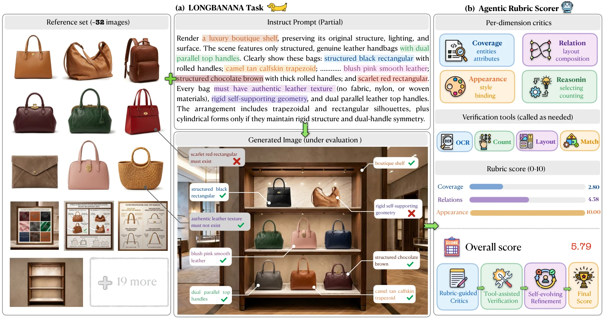
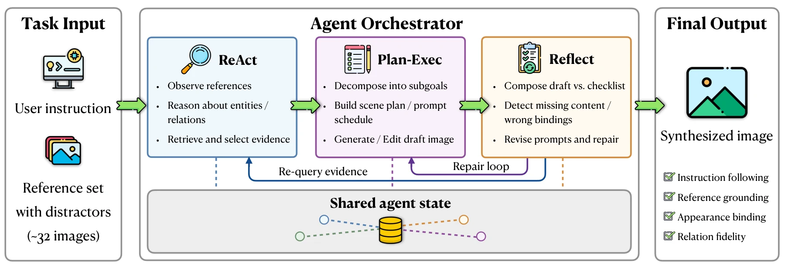

#  LongBanana

## An Expert-Verified Benchmark for Long-Context Multi-Reference Image Synthesis

<p align="center">
  <a href="https://hooccee.github.io/LongBanana-v2/"></a>
  <a href="https://hooccee.github.io/LongBanana-v2/gallery/"></a>
  <a href="#paper"></a>
  <a href="#dataset-and-task-format"></a>
</p>

**90 tasks · 9 categories · approximately 32 references per task · 4,670 atomic evaluation items**

LongBanana evaluates whether image-generation systems can retrieve dispersed visual
evidence, reject distractors, bind entities and relations correctly, and compose
one coherent final image from many references. It measures reference-grounded
correctness beyond visual plausibility or a single holistic quality score.

This repository provides the OpenClaw implementation of **LongBanana-Gen** and
**LongBanana-Eval**: image-generation tools, a static agentic checklist judge,
optional visual subagents, and benchmark task conversion utilities.

[](assets/longbanana-overview.pdf)

*Figure 1. LongBanana task and evaluation overview: multi-reference synthesis
inputs, candidate outputs, and graph-grounded checklist evaluation. Click the
figure for the original PDF.*


## Benchmark

Each task pairs a synthesis instruction and a heterogeneous reference inventory
with a graph-grounded checklist. The entity–relation graph connects required
content, local bindings, relations, and scene-wide constraints to atomic,
visually verifiable evaluation items.

| Suite | Category | Capability | Tasks |
| --- | --- | --- | ---: |
| Scene Composition | SCC | Semantic Coverage & Consistency | 10 |
| Scene Composition | RGC | Relational Graph Consistency | 10 |
| Scene Composition | LAC | Layout Arrangement Consistency | 10 |
| Visual Appearance | GAC | Global Appearance Conditioning | 10 |
| Visual Appearance | LAB | Local Appearance Binding | 10 |
| Visual Appearance | AHC | Appearance Harmonization & Coherence | 10 |
| Reference Reasoning | SEL | Selection & Retrieval | 10 |
| Reference Reasoning | TSR | Temporal / State Reasoning | 10 |
| Reference Reasoning | AGG | Counting & Aggregation | 10 |

The taxonomy describes each task's dominant demand. The three grading dimensions
used across tasks are **Content Fidelity**, **Relational Binding**, and **Global
Constraint Satisfaction**.

## Generation and Evaluation

**LongBanana-Gen** uses an agent harness to inspect references, plan generation
steps, call an image backend, and revise intermediate outputs. Its **RPR** workflow
combines ReAct, Plan–Exec, and Reflect for evidence retrieval, decomposition, and
iterative repair. Included MCP servers support Gemini, Azure GPT Image, and
Seedream-compatible backends. The paper also studies direct baselines,
Hermes-Agent, and OpenCode; this release contains the OpenClaw implementation.

[](assets/longbanana-gen.pdf)

*Figure 18. LongBanana-Gen agent-orchestrator workflow: ReAct retrieves reference
evidence, Plan–Exec decomposes synthesis into subgoals, and Reflect checks drafts
against checklist obligations before repair. Click the figure for the original PDF.*

**LongBanana-Eval** judges individual checklist obligations against a candidate
image and relevant references. Optional OCR, detection/counting, layout, and
identity subagents gather additional evidence. Labels use **Fail = 0**,
**Uncertain = 1**, and **Pass = 2**. A case's checklist-average score is:

```text
Case score = 100 × sum(item scores) / (2 × number of items)
```

The paper's subclass and overall averages pool the relevant checklist items.
**P@70%** is a separate metric: the fraction of tasks reaching 70 under the paper's
difficulty-weighted task scoring. Invalid responses are recorded separately from
valid ternary judgments.

## Results Reported in the Paper

The following results are transcribed from the accompanying manuscript; they are
not recomputed by installing this repository.

**Image backends with OpenClaw + RPR**

| Image generator | Checklist average ↑ | P@70% ↑ |
| --- | ---: | ---: |
| Seedream 4 | 63.6 | 18.9 |
| GPT Image 1 | 61.8 | 17.8 |
| Nano Banana 2 | **78.4** | **47.8** |

**Judge–human agreement**

| Judge | Pearson ↑ | Spearman ↑ | Kendall ↑ |
| --- | ---: | ---: | ---: |
| VLM-as-judge | 0.8413 | 0.8248 | 0.6437 |
| LongBananaEval (agentic checklist judge) | **0.8707** | **0.8602** | **0.6727** |

The manuscript reports 900 audited outputs across 90 cases and 10 generation
conditions, with 46,700 reviewed checklist labels. Its independently double-labeled
subset has 89.4% exact agreement and 0.83 quadratic weighted kappa.

## Installation

Use Python 3.11+ and Node.js 22.12+. Run commands from the repository root.

```bash
git clone https://github.com/Hooccee/LongBanana_open.git
cd LongBanana_open
python -m pip install -e '.[test]'
npm install --prefix openclaw-runtime --omit=dev --ignore-scripts
npm ci --prefix image-gen-mcp
npm run build --prefix image-gen-mcp
node openclaw-runtime/openclaw.mjs --help
```

Copy `.env.example` to `.env` and configure your planning model, judge model, and
image backend. The bundled judge uses Gemini through Google Vertex AI; set
`GOOGLE_APPLICATION_CREDENTIALS`, `GOOGLE_CLOUD_PROJECT`, and
`AGENT_JUDGE_GEMINI_MODEL`. See
[`examples/image_gen_config.example.json`](examples/image_gen_config.example.json)
for image-backend configuration and [the runtime guide](docs/runtime_guide.md)
for detailed task fields and commands.

## Dataset and Task Format

**Hugging Face Dataset: Coming soon.** The dataset download link will be added
here when available. Dataset assets and human annotations are distributed
separately from the code. Explore examples in the
[Gallery](https://hooccee.github.io/LongBanana-v2/gallery/).

To use a local benchmark release:

```bash
openclaw-longbanana-build-release-tasks --release-root /path/to/benchmark_release
```

This creates `openclaw/generation_tasks.jsonl`, `openclaw/judge_tasks_target.jsonl`,
and `openclaw/task_manifest.json`. Generation tasks contain the prompt, references,
and optional background. Judge tasks contain the candidate image, relevant
references, question, guide, and answer options. Image paths may be relative to
the task JSONL file.

`judge_tasks_target.jsonl` evaluates the release's target images. To evaluate your
own generations, point each row's `candidate_path` to your saved output; see
[`examples/judge_tasks.example.jsonl`](examples/judge_tasks.example.jsonl).

## Generate Images

```bash
openclaw-longbanana-generate \
  --tasks-jsonl /path/to/benchmark_release/openclaw/generation_tasks.jsonl \
  --backends gemini --strategies pipe \
  --results-dir runs/generation --workers 1
```

Choose `gemini`, `azure`, or `seedream` for the configured backend. Add
`--limit 1 --dry-run` to inspect a single task without making model calls.

## Evaluate Generated Images

```bash
openclaw-longbanana-judge \
  --tasks-jsonl /path/to/judge_tasks.jsonl \
  --judge-projects openclaw --openclaw-judge-subagents \
  --invalid-retries 5 --results-dir runs/judge --workers 1
```

Omit `--openclaw-judge-subagents` to run the main judge without visual subagents.
Outputs include `judgments.csv`, `summary.json`, and per-task logs. See CLI
`--help` for resume, concurrency, and timeout options.

## Repository Structure

```text
src/openclaw_longbanana/   Generation, judge, and task conversion
image-gen-mcp/            Image-backend MCP servers
openclaw-runtime/         Bundled OpenClaw runtime
openclaw_skills/          Visual judge subagent instructions
examples/                Task and configuration examples
tests/                   Offline tests
```

Run offline tests with `pytest -q`. Live runs require API access and dataset assets.

## Acknowledgments

This implementation builds on [OpenClaw](https://github.com/openclaw/openclaw)
and the Model Context Protocol ecosystem. The bundled OpenClaw runtime retains
its [MIT license](openclaw-runtime/LICENSE).

## Paper

**arXiv Paper: Coming soon.** The paper link and arXiv identifier will be added
here when available. Visit the
[Project Page](https://hooccee.github.io/LongBanana-v2/) for the benchmark overview.

## Citation

```bibtex
@misc{cao2026longbanana,
  title={LongBanana: An Expert-Verified Benchmark for Long-Context Multi-Reference Image Synthesis},
  author={Cao, Haoxiang and Zhang, Yuxuan and Du, Penghui and others},
  year={2026},
  url={https://github.com/Hooccee/LongBanana_open}
}
```
